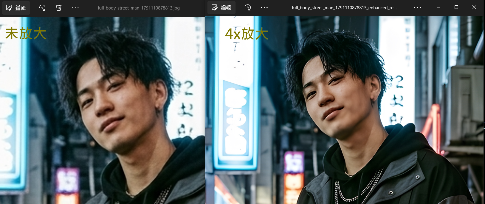
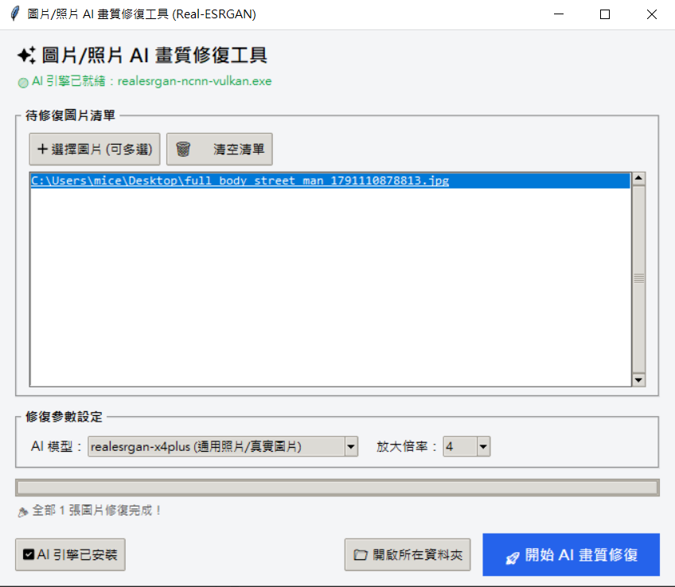

# 🖼️ 圖片/照片 AI 畫質修復工具 (Real-ESRGAN GUI)

一款專為 Windows 設計的輕量、免繁雜配置的**本機 AI 圖片超解析度修復與放大工具**。  
基於 **Real-ESRGAN** 深度學習神經網路與 ncnn Vulkan 加速引擎，可將模糊、低解析度或老舊照片無損放大 **2x / 4x**，精準重建髮絲、膚質與材質紋理。

---

## 🌟 效果對比展示 (Before & After)



> **實測效果**：原圖低解析度人物面部細節較為模糊，經過 `realesrgan-x4plus` 模型 4x 超解析度重建後，眼神、髮絲、皮膚質感與服裝金屬細節皆獲得極高清晰度重建。

---

## 🖥️ 軟體介面 (GUI Preview)



- **原生輕量**：採用 Python 內建 GUI，免安裝肥大的第三方視窗框架。
- **背景執行**：批次處理時介面流暢不卡頓，具備即時進度條與狀態指示。
- **一鍵開啟**：處理完成後可直接點擊「開啟所在資料夾」檢視產出成果。

---

## ✨ 核心特色

1. **🚀 深度學習神經網路重建**：
   - `realesrgan-x4plus`：針對真實人像、風景與日常照片的通用超解析度修復。
   - `realesrgan-x4plus-anime`：動漫、插畫與二次元線條特化修復，保持邊緣平滑銳利。
   - `realesr-animevideov3`：高速模式，兼顧速度與品質。
2. **⚡ 免配 Python 深度學習環境**：
   - 無需安裝數 GB 的 PyTorch、CUDA 或繁複環境變數，基於 ncnn Vulkan 輕量執行檔即可流暢運行。
3. **📂 批次多圖處理**：
   - 支援一次選取多張圖片（Ctrl / Shift 多選），自動循序批次完成修復。
4. **🛡️ 三段式降級兜底保障**：
   - 若未啟用 AI 引擎，自動降級為 Pillow 高品質 Lanczos 2x 插值 + UnsharpMask 銳化濾鏡；皆無時自動調用 ffmpeg。

---

## 🚀 快速上手

### 1. 一鍵啟動 (推薦)
在專案根目錄下，直接雙擊：
👉 **`run_enhance.bat`**

### 2. 使用步驟
1. 點擊 **「➕ 選擇圖片」**，選取一張或多張圖片（支援 `.jpg`、`.png`、`.webp` 等格式）。
2. 在 **「修復參數設定」** 選擇適用的 AI 模型與放大倍率（2x 或 4x）。
3. 點擊 **「🚀 開始 AI 畫質修復」**，進度條將即時顯示各圖片處理進度。
4. 修復完成後，點擊 **「📁 開啟所在資料夾」** 即可檢視新產生的高畫質圖片（檔名後綴自動帶有 `_enhanced`）。

---

## 💻 命令列模式 (CLI)

除了圖形視窗外，亦支援直接於終端機傳參或拖曳圖片處理：

```bash
# 單張或多張圖片批次修復
python enhance_image.py "C:\path\to\photo1.jpg" "C:\path\to\photo2.png"
```

---

## 📁 專案結構

```text
圖片畫質提高工具/
├── gui.py                   # 圖形化介面主程式 (Tkinter / ttk)
├── enhance_image.py         # 核心修復邏輯 (AI / Pillow / ffmpeg 三段式)
├── download_ai_engine.py    # AI 引擎下載與解壓輔助腳本
├── run_enhance.bat          # 一鍵免命令列啟動批次檔
├── DEMO.png                 # 修復前後效果展示圖
├── Demo2.png                # 軟體執行介面截圖
├── realesrgan-ncnn-vulkan.exe # (已內建) Real-ESRGAN Vulkan 推理引擎
└── models/                  # (已內建) 神經網路權重檔 (.bin, .param)
```

---

## 📜 銘謝與依賴

- **[Real-ESRGAN](https://github.com/xinntao/Real-ESRGAN)** by Xintao Wang et al. (BSD-3-Clause)
- **[ncnn](https://github.com/Tencent/ncnn)** by Tencent
